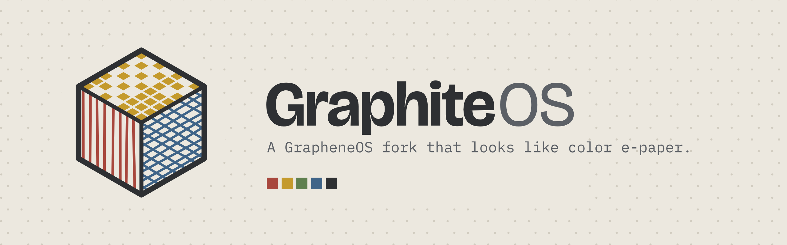

<picture>
  <source media="(prefers-color-scheme: dark)" srcset="assets/github/readme-banner-dark.png">
  
</picture>

# GraphiteOS

A minimal-diff fork of [GrapheneOS](https://grapheneos.org) for the Pixel 9 Pro (`caiman`).

The only change from GrapheneOS is a display filter. Everything on the built-in screen looks like it is on a color e-ink panel:

- warm, desaturated colors
- a palette of about 300 colors with 2px ordered dithering
- a new frame shown about 15 times per second

Apps can't tell the filter is there. They render and present frames at the normal rate.

The filter is skipped while any of these is on screen:

- photo and camera apps
- camera previews
- DRM-protected video
- video in calling apps

External displays (casting, Android Auto, wired monitors) and screenshots are never filtered.

## What's in here

| Path | What it is |
|---|---|
| `patches/frameworks/native/` | The filter. It lives in SurfaceFlinger and RenderEngine; the bypass app lists are in `SurfaceFlinger.cpp`. |
| `patches/packages/apps/Updater/` | Points the stock Updater at this repo's GitHub releases. |
| `overlay/` | Files that replace upstream files as-is. Currently only the GraphiteOS boot animation (`branding/bootanimation/1280.zip`, the Pixel 9 Pro size). |
| `assets/` | Brand kit: logos, vector masters, GitHub banners, and the boot animation sources. |
| `tools/einkfilter.py` | Previews the filter on an image using the same math as the shader. |
| `certs/caiman/` | Public signing certificates and the AVB key (`avb_pkmd.bin`). |
| `scripts/generate-keys.sh` | One-time signing key generation. |
| `ci/`, `.github/workflows/` | Release automation. |

## Releases

1. `watch-upstream.yml` checks GrapheneOS stable for caiman once a day. It is off until the repository variable `AUTO_RELEASE` is `true`.
2. When upstream has a newer release, `watch-upstream.yml` starts `release.yml`, which:
   1. applies the patches to the new tag on the GitHub runner, so a conflict stops it before any server is billed;
   2. asks Claude to review upstream changes against the patches;
   3. creates a temporary Hetzner server to build and sign the release;
   4. checks the signature and the update metadata;
   5. uploads the release and deletes the server.
3. If the review is clean, the release is published and phones get it through the normal Updater. Otherwise it stays a draft and an issue is opened.

`cleanup.yml` deletes any expired Hetzner server every 30 minutes as a safety net.

Toggle the filter for testing (not persistent, adb only):

```
adb shell service call SurfaceFlinger 1999 i32 0   # off
adb shell service call SurfaceFlinger 1999 i32 1   # on
```

Tune the look live (adb only, resets on reboot; an empty value restores the default). Changes show on the next screen update.

```
adb shell setprop debug.eink.dither 1.5     # set one value
adb shell setprop debug.eink.dither ''      # back to the default
adb shell getprop | grep debug.eink         # show what is set
```

| Property | Default | Range | Effect |
|---|---|---|---|
| `tones` | 16 | 2–64 | lightness levels |
| `rings` | 3 | 0–8 | color strength levels (0 = greyscale) |
| `hues` | 12 | 1–48 | hue directions |
| `saturation` | 0.38 | 0–3 | how much of the original color is kept |
| `warmth` | 1 | 0–10 | paper tint (0 = neutral grey) |
| `dither` | 1 | 0–8 | dither strength (0 = flat bands) |
| `cell` | 2 | 1–16 | dither pixel size |
| `black` | 0.32 | 0–1 | ink black lightness |
| `white` | 0.92 | 0–1 | paper white lightness |
| `fps` | 15 | 1–240 | screen updates per second |
